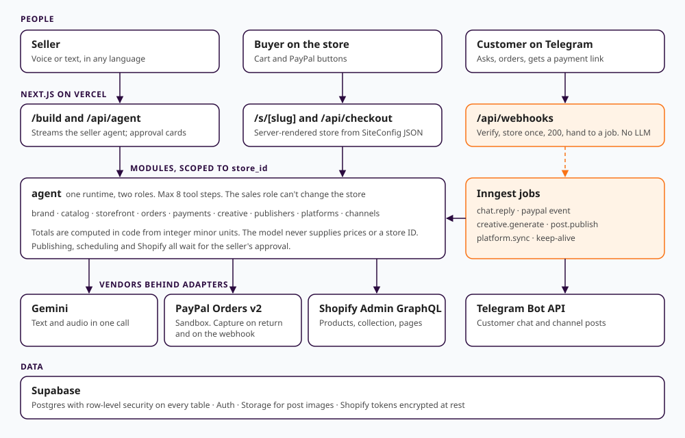

# AxoriOS

Say it "axo-ree-os". A voice-first AI agent that takes a non-technical seller anywhere in the world from a business idea to a first paid order.

A seller describes their business by voice or text, in any language. AxoriOS builds a brand kit and a designed store, takes payment through PayPal, answers customers on Telegram, makes on-brand posts and schedules them, and copies the catalog to Shopify.

Built for the PayPal AI Hackathon. PayPal runs in sandbox only, so no real money moves.

**The demo story:** a Lagos cake shop prices in naira. A buyer in the UK orders a birthday cake for family in Lagos and pays in US dollars through PayPal.

## Try it

- **Live demo store:** <https://axorios.vercel.app/s/demo>
- **Chat with the store on Telegram:** <https://t.me/EbukahTgBot?start=demo>
- **Seller side:** sign in at <https://axorios.vercel.app>

The demo seller login and the PayPal sandbox buyer login are in the testing notes of the Devpost submission.

To see the flow from the buyer's side:

1. Open the demo store, add a cake to the cart and enter delivery details.
2. Note both amounts: the naira price, and the US dollars PayPal will charge at a locked rate.
3. Pay as the sandbox buyer. The order page confirms payment, and the order appears on the seller's dashboard with both amounts.

## What works

| Area | What it does |
|---|---|
| Voice | The mic sends audio straight to the agent, with no separate speech-to-text step. It shows what it heard, then acts on it. Tested with a synthetic voice in English and Nigerian Pidgin |
| Brand and store | Brand kit from a conversation. Three Market templates that take the brand's colours and fonts. Live draft preview, click a section and change it by chat, undo, publish after approval |
| Payments | PayPal Orders v2. Totals are computed on the server in integer minor units. Currencies PayPal can't charge, such as naira, convert at a rate locked on the order, and the buyer sees both amounts before paying. Capture runs on the return page and on the webhook, and repeats change nothing |
| Chat selling | A sales agent on Telegram answers from one store's catalog, in the customer's language, creates an order and sends a PayPal link |
| Marketing | Campaigns of on-brand images and captions. The seller approves and schedules them for a Telegram channel, or downloads a zip with each image, caption and suggested time |
| Shopify | Copies products, a collection and pages to a Shopify store after approval. Syncing again updates rather than duplicates |

### Limits

- **Shopify themes:** Shopify refused our theme write, because `themeFilesUpsert` needs an exemption it grants separately. The seller gets a link to the theme editor with their colours and fonts listed.
- **Shared accounts:** this build has one Telegram channel and one Shopify dev store, so only the demo store can post to them. Other stores get the download pack.
- **Images:** post images come from brand templates, not an AI image model, because image generation needs paid API access. It's one adapter away: see below.
- **Not in this build:** WhatsApp (an untested adapter sits switched off behind `WHATSAPP_ENABLED`), Instagram and Facebook, a web chat bubble, a seller inbox, a logo generator, and photo uploads.

## How it's built



Next.js with TypeScript, Supabase, the Vercel AI SDK with Gemini, PayPal Orders v2, Inngest, the Telegram Bot API and the Shopify Admin API.

Some rules are enforced in code rather than asked of the model:

- **Money:** the model never supplies a price or total. Prices come from the database, and code writes the payment details a customer sees.
- **Store scoping:** every tool gets its store from the session or the chat's binding, never from model output. Row-level security covers every table.
- **Approvals:** publishing, scheduling and Shopify actions show a card, and run only after the seller approves.
- **Untrusted input:** customer messages are data. The sales agent can't change products, prices or the store.
- **Webhooks:** verify the signature, store the event once, return 200, and do the work in a background job. The model is never called inside a webhook request.
- **Site rendering:** the agent edits a validated JSON config. It never writes page code.

Each vendor sits behind an interface in `src/modules/<name>/adapters/`, so a new image model, payment provider or chat channel is one new file plus one registry entry, with no change to the agent.

## Run it yourself

You need Node 22 or newer, and free accounts with Supabase, Google AI Studio, PayPal Developer, Telegram (a bot from @BotFather), Inngest and Vercel. Shopify is optional.

```bash
git clone https://github.com/ChukwuebukaHenrey/axorios.git
cd axorios
npm install
cp .env.example .env.local   # then fill it in: every key has a comment
```

Apply the database schema, then create the demo seller and store:

```bash
npx supabase db push --db-url "<your Supabase session pooler connection string>"
npx tsx --env-file=.env.local scripts/seed-demo-user.mts
npx tsx --env-file=.env.local scripts/seed-demo-store.mts
```

Start the app and the local job runner, each in its own terminal:

```bash
npm run dev
npx inngest-cli@latest dev
```

Open <http://localhost:3000> and sign in with the `DEMO_SELLER_EMAIL` and `DEMO_SELLER_PASSWORD` you set. The store is at `/s/demo`.

PayPal and Telegram must reach a public URL to call the webhooks. Deploy to Vercel, then register them with `scripts/register-paypal-webhook.mts` and `scripts/register-telegram-webhook.mts`.

```bash
npm test        # unit tests
npm run build   # production build
```

`scripts/e2e-*.mts` run the real flows against a deployment, and say at the top what they leave behind.

## License

[MIT](LICENSE)
